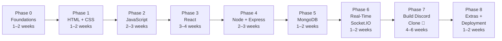
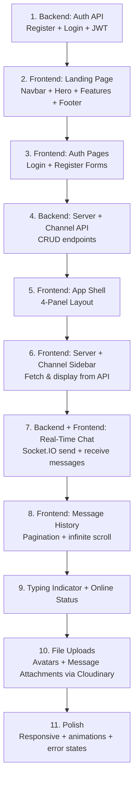

# Discord Clone — Full-Stack Learning Plan

> [!IMPORTANT]
> This plan is specifically designed around building the Discord Clone project.
> Every topic you learn maps directly to a feature you'll build. No wasted time.

---

## 🗺️ Overview — Your Journey at a Glance



**Total estimated time:** ~16–24 weeks (studying 1–3 hrs/day)

---

## Phase 0 — Dev Environment Setup ⚙️
**Duration:** 2–3 days

Before writing a single line of code, get your tools ready.

### What to Install
| Tool | Purpose | Link |
|------|---------|------|
| **VS Code** | Code editor | code.visualstudio.com |
| **Node.js (LTS)** | Runs JavaScript outside browser | nodejs.org |
| **Git** | Version control | git-scm.com |
| **MongoDB Compass** | GUI for your database | mongodb.com/compass |
| **Postman** | Test your API endpoints | postman.com |
| **Chrome DevTools** | Debug frontend (built-in) | F12 in Chrome |

### VS Code Extensions to Install
- `ESLint` — Catch JS errors
- `Prettier` — Auto-format code
- `ES7+ React Snippets` — React shortcuts
- `Tailwind CSS IntelliSense` — Autocomplete classes
- `Thunder Client` — Postman inside VS Code
- `GitLens` — Better Git history

### Quick Wins
```bash
# Verify everything works
node --version     # should print v20+
npm --version      # should print 10+
git --version      # should print git version
```

---

## Phase 1 — HTML & CSS (The Landing Page) 🎨
**Duration:** 1–2 weeks
**Discord Clone Connection:** Build the entire Discord landing page UI

### What to Learn

#### HTML Essentials
- [ ] Semantic tags: `<nav>`, `<section>`, `<header>`, `<footer>`, `<main>`
- [ ] Forms: `<input>`, `<button>`, `<form>`, `<select>`
- [ ] Links, images, lists
- [ ] `<div>` vs semantic elements (when to use which)

#### CSS Core
- [ ] Box model (margin, padding, border)
- [ ] Flexbox — **most important for Discord's layout**
- [ ] CSS Grid — for footer columns, feature grids
- [ ] Position: `fixed`, `sticky`, `relative`, `absolute`
- [ ] Variables: `--blurple: #5865F2`
- [ ] Transitions & hover effects
- [ ] `z-index` (navbar needs `z-50`)
- [ ] Media queries for responsive design

#### CSS Gradients (Discord-Specific)
```css
/* You'll use this for the hero section */
background: linear-gradient(135deg, #5865F2 0%, #7289DA 50%, #EB459E 100%);
```

### Mini Project — Build This
> Build the **Discord landing page** in plain HTML + CSS:
> - Sticky navbar with 8 links + Login button
> - Hero section with gradient background + 2 CTA buttons
> - 3 feature sections (zig-zag layout)
> - CTA banner
> - 4-column footer with social icons

### Resources
- MDN Web Docs (free) — developer.mozilla.org
- CSS-Tricks Flexbox Guide (free)
- Kevin Powell on YouTube — CSS master

---

## Phase 2 — JavaScript (Making It Interactive) ⚡
**Duration:** 2–3 weeks
**Discord Clone Connection:** DOM events, fetch data from API, handle user input

### What to Learn

#### JS Fundamentals
- [ ] Variables: `let`, `const`, `var`
- [ ] Data types: strings, numbers, booleans, arrays, objects
- [ ] Functions (regular + arrow functions `() => {}`)
- [ ] Array methods: `.map()`, `.filter()`, `.reduce()`, `.find()`
- [ ] Destructuring: `const { name, email } = user`
- [ ] Spread operator: `...arr`
- [ ] Template literals: `` `Hello ${name}` ``
- [ ] Modules: `import` / `export`

#### Async JavaScript — **Critical for Discord**
- [ ] `setTimeout` / `setInterval`
- [ ] Promises `.then().catch()`
- [ ] `async/await` — you'll use this constantly
- [ ] `fetch()` API — calling your backend REST API
- [ ] Error handling with `try/catch`

#### DOM Manipulation
- [ ] `document.querySelector()`
- [ ] `addEventListener()` — click, submit, keypress
- [ ] `innerHTML`, `textContent`, `classList`

#### Browser APIs You'll Need
- [ ] `localStorage` — storing JWT tokens
- [ ] `window.navigator.userAgent` — OS detection for download button

### Mini Project — Build This
> Add JavaScript to your landing page:
> - Navbar: highlight active link on scroll
> - Hero: auto-detect OS and change button text to "Download for Windows/Mac"
> - Smooth scroll when clicking nav links
> - Login button: redirect to `/login`

### Resources
- javascript.info (best free JS resource)
- Traversy Media on YouTube
- 30 Days of JavaScript (GitHub)

---

## Phase 3 — React (Component-Based UI) ⚛️
**Duration:** 3–4 weeks
**Discord Clone Connection:** Build the entire app UI — landing page, login, app shell, chat

### What to Learn

#### React Basics
- [ ] `create vite@latest` — project setup
- [ ] JSX syntax (HTML inside JavaScript)
- [ ] Components — functional components
- [ ] Props — passing data between components
- [ ] `useState` — local component state
- [ ] `useEffect` — run code on mount/update
- [ ] Lists & keys: `.map()` to render message lists
- [ ] Conditional rendering: `{isLoggedIn && <Dashboard />}`

#### React Intermediate
- [ ] `useContext` — global state (auth user)
- [ ] `useRef` — scroll chat to bottom automatically
- [ ] Custom Hooks — `useAuth()`, `useChat()`, `useSocket()`
- [ ] React Router v6:
  - `<BrowserRouter>`, `<Routes>`, `<Route>`
  - `useNavigate()` — redirect after login
  - `useParams()` — get `:serverId`, `:channelId` from URL
  - Protected routes (redirect to login if not authenticated)

#### Tailwind CSS with React
- [ ] Install & configure Tailwind in Vite
- [ ] Utility classes: `flex`, `grid`, `h-screen`, `overflow-hidden`
- [ ] Add Discord colors to `tailwind.config.js`
- [ ] Responsive: `md:flex`, `hidden md:block`
- [ ] `clsx` / `cn()` for conditional class merging

#### State Management
- [ ] **Zustand** (simpler than Redux — perfect for Discord clone)
  ```js
  // useAuthStore.js
  const useAuthStore = create((set) => ({
    user: null,
    setUser: (user) => set({ user }),
  }));
  ```

#### React Query (TanStack Query)
- [ ] `useQuery()` — fetch server list, channel list
- [ ] `useMutation()` — post a message, create a server
- [ ] Automatic caching & background refetch

### Pages to Build in React
| Page | Route | Description |
|------|-------|-------------|
| `LandingPage` | `/` | The Discord homepage clone |
| `LoginPage` | `/login` | Email + password form |
| `RegisterPage` | `/register` | Signup form |
| `AppLayout` | `/app` | 4-panel shell (server + channel + chat + members) |
| `ServerPage` | `/app/:serverId/:channelId` | Active channel chat view |
| `NotFoundPage` | `*` | 404 page |

### Mini Project — Build This
> Convert your HTML landing page to React:
> - `<Navbar />` with `navLinks` array mapped to `<li>` items
> - `<HeroSection />` with OS-detected CTA button
> - `<FeatureSection />` reusable component (pass heading + body + image as props)
> - `<Footer />` with 4-column grid

### Resources
- React official docs (react.dev)
- Codevolution React series (YouTube)
- Jack Herrington — React hooks deep dives

---

## Phase 4 — Node.js + Express (The Backend API) 🖥️
**Duration:** 2–3 weeks
**Discord Clone Connection:** Auth, server management, message history, file uploads

### What to Learn

#### Node.js Basics
- [ ] How Node works (event loop, non-blocking I/O)
- [ ] `require()` vs `import`
- [ ] `fs` module — reading/writing files
- [ ] `process.env` — environment variables
- [ ] `npm init`, `package.json`, `scripts`
- [ ] `nodemon` for auto-restart during development

#### Express Framework
- [ ] `app.get()`, `app.post()`, `app.put()`, `app.delete()`
- [ ] Route parameters: `/api/servers/:serverId`
- [ ] Query strings: `/messages?page=1&limit=50`
- [ ] `req.body`, `req.params`, `req.query`, `req.headers`
- [ ] Middleware: `app.use(express.json())`
- [ ] Error handling middleware `(err, req, res, next)`
- [ ] Router: `express.Router()` — split routes into files
- [ ] `cors` — allow React app to call your API
- [ ] `helmet` — security headers

#### Authentication — JWT + bcrypt
- [ ] Password hashing with `bcryptjs`
  ```js
  const hash = await bcrypt.hash(password, 12);
  const match = await bcrypt.compare(password, hash);
  ```
- [ ] Signing a JWT
  ```js
  const token = jwt.sign({ id: user._id }, process.env.JWT_SECRET, { expiresIn: '7d' });
  ```
- [ ] Verifying JWT in middleware
- [ ] Sending token from React (Authorization header)
- [ ] Storing token in `localStorage`

#### File Uploads
- [ ] `multer` — handle `multipart/form-data`
- [ ] `cloudinary` + `multer-storage-cloudinary`
- [ ] Upload avatars, server icons, message attachments

### REST API Endpoints to Build
```
POST  /api/auth/register
POST  /api/auth/login
GET   /api/auth/me

POST  /api/servers           → create server
GET   /api/servers           → get user's servers
POST  /api/servers/:id/join  → join server

POST  /api/servers/:id/channels  → create channel
GET   /api/servers/:id/channels  → list channels

GET   /api/channels/:id/messages?page=1  → fetch history
POST  /api/channels/:id/messages         → post message
DELETE /api/messages/:id                 → delete message
```

### Mini Project — Build This
> Build and test with Postman:
> - Register a user (hashed password stored)
> - Login and receive JWT
> - Use JWT to create a server + channel
> - Post a message to a channel
> - Fetch message history with pagination

### Resources
- Traversy Media — Express crash course (YouTube)
- Net Ninja — Node.js series (YouTube)
- Express official docs (expressjs.com)

---

## Phase 5 — MongoDB + Mongoose (The Database) 🍃
**Duration:** 1–2 weeks
**Discord Clone Connection:** Store users, servers, channels, messages

### What to Learn

#### MongoDB Concepts
- [ ] Documents vs Rows (JSON-like data)
- [ ] Collections vs Tables
- [ ] `_id` — auto-generated ObjectId
- [ ] CRUD: Create, Read, Update, Delete
- [ ] Filtering: `{ status: 'online' }`
- [ ] Sorting: `.sort({ createdAt: -1 })`
- [ ] Pagination: `.skip(50).limit(50)`
- [ ] MongoDB Atlas — free cloud database setup

#### Mongoose ODM
- [ ] Define schemas + models
- [ ] `required`, `unique`, `default`, `enum`
- [ ] Relationships via `ObjectId` refs
  ```js
  owner: { type: mongoose.Schema.Types.ObjectId, ref: 'User' }
  ```
- [ ] `.populate()` — join related documents
  ```js
  await message.populate('sender', 'username avatar');
  ```
- [ ] Indexes — speed up message queries
  ```js
  messageSchema.index({ channel: 1, createdAt: -1 });
  ```
- [ ] Mongoose middleware (pre-save hooks for password hashing)
- [ ] `timestamps: true` — auto `createdAt` / `updatedAt`

### 4 Models to Build for Discord Clone
```
User     → username, email, password, avatar, status
Server   → name, icon, owner, members[], channels[]
Channel  → name, type (text/voice), server
Message  → content, attachment, sender, channel
```

### Resources
- MongoDB University (free — university.mongodb.com)
- Net Ninja — MongoDB series (YouTube)
- Mongoose docs (mongoosejs.com)

---

## Phase 6 — Real-Time with Socket.IO 🔌
**Duration:** 1–2 weeks
**Discord Clone Connection:** Live chat, typing indicators, online/offline status

### What to Learn

#### WebSockets Concept
- [ ] Difference between HTTP (request-response) and WebSocket (persistent connection)
- [ ] When to use REST vs WebSocket
  - REST → fetch old messages, login, create server
  - Socket.IO → new message, typing, online status

#### Socket.IO — Server Side
- [ ] Setup with Express `http.createServer(app)`
- [ ] `io.on('connection', socket => {})`
- [ ] Rooms: `socket.join(channelId)`, `socket.leave(channelId)`
- [ ] Emit to room: `io.to(channelId).emit('new_message', data)`
- [ ] Emit to others: `socket.to(channelId).emit(...)`
- [ ] Disconnect: `socket.on('disconnect', () => {})`
- [ ] Auth middleware for sockets (JWT verification)

#### Socket.IO — Client Side (React)
- [ ] `socket.io-client` install
- [ ] `SocketProvider` context pattern
- [ ] `useEffect` to listen for events:
  ```js
  useEffect(() => {
    socket.on('new_message', (msg) => {
      setMessages(prev => [...prev, msg]);
    });
    return () => socket.off('new_message');
  }, [socket]);
  ```
- [ ] Emit events: `socket.emit('send_message', { channelId, content })`
- [ ] Cleanup: always remove listeners on unmount

### Events to Build for Discord Clone
| Client Emits | Server Broadcasts | Feature |
|--------------|------------------|---------|
| `join_channel` | — | Enter a channel |
| `send_message` | `new_message` | Live chat |
| `typing` | `user_typing` | Typing indicator |
| *(disconnect)* | `user_offline` | Presence status |

### Resources
- Socket.IO official docs (socket.io/docs)
- Traversy Media — Socket.IO crash course (YouTube)

---

## Phase 7 — Build the Discord Clone 🚀
**Duration:** 4–6 weeks
**This is where everything comes together.**

### Build Order (Follow This Exactly)



### Feature Checklist
#### Landing Page
- [ ] Sticky navbar (8 links + Login button)
- [ ] Hero section with gradient + dual CTA buttons + OS detection
- [ ] Feature section 1 — "Create an invite-only place"
- [ ] Feature section 2 — "Where hanging out is easy"
- [ ] Feature section 3 — "From a few to a fandom"
- [ ] Bottom CTA banner
- [ ] 4-column footer with social icons

#### Auth System
- [ ] Register form (username, email, password, avatar upload)
- [ ] Login form (email, password)
- [ ] JWT stored in `localStorage`
- [ ] Protected route guard (redirect to `/login` if not authenticated)
- [ ] "Me" endpoint to restore session on page refresh

#### App Shell
- [ ] Server list sidebar (leftmost, `72px` wide, dark)
- [ ] Channel list sidebar (`240px`, shows text + voice channels)
- [ ] Chat area (flex-1, scrollable messages)
- [ ] Member list sidebar (`240px`, online/offline grouped by role)

#### Real-Time Chat
- [ ] Send message via Socket.IO
- [ ] Receive messages live (append to list)
- [ ] Message shows: avatar, username, timestamp, content
- [ ] Auto-scroll to latest message (`useRef`)
- [ ] Typing indicator ("User is typing...")
- [ ] Online/offline status dots on member list

#### Server & Channel Management
- [ ] Create server modal (name + icon upload)
- [ ] Join server via invite link
- [ ] Create text/voice channel inside a server
- [ ] Switch between channels (re-join socket room)

---

## Phase 8 — Extras & Deployment 🌐
**Duration:** 1–2 weeks

### Extra Features to Add (Bonus)
| Feature | Difficulty | Tech |
|---------|-----------|------|
| **Message edit & delete** | Easy | Socket.IO + MongoDB |
| **Message reactions (emoji)** | Medium | Socket.IO |
| **Direct Messages (DMs)** | Medium | New Socket room per user pair |
| **User profile settings** | Easy | REST + Cloudinary |
| **Dark/Light mode toggle** | Easy | Tailwind `dark:` classes |
| **Server invite links** | Medium | Generate unique token, join on visit |
| **Role-based permissions** | Hard | Server member roles + middleware |
| **Voice channels** | Very Hard | WebRTC + LiveKit / Mediasoup |
| **Message search** | Medium | MongoDB text index |
| **Notifications** | Medium | Socket.IO + browser Notification API |

> [!WARNING]
> Voice channels require WebRTC — a completely separate learning track. Build all text features first, then tackle voice.

### Deployment
| Layer | Service | Notes |
|-------|---------|-------|
| **React Frontend** | **Vercel** (free) | Connect GitHub repo, auto-deploy |
| **Node + Express API** | **Render** (free) | Add env vars in dashboard |
| **MongoDB** | **MongoDB Atlas** (free) | 512MB free cluster |
| **Files / Images** | **Cloudinary** (free) | 25GB free storage |

```bash
# Frontend — build for production
npm run build
# → uploads /dist folder to Vercel automatically via GitHub

# Backend — Render reads your package.json
# Start command:  node server.js
# Build command:  npm install
```

---

## 📦 All npm Packages You'll Need

### Frontend
```bash
npm create vite@latest discord-clone -- --template react
cd discord-clone
npm install \
  react-router-dom \
  axios \
  socket.io-client \
  zustand \
  @tanstack/react-query \
  clsx \
  tailwind-merge

npm install -D tailwindcss postcss autoprefixer
npx tailwindcss init -p
```

### Backend
```bash
mkdir discord-api && cd discord-api
npm init -y
npm install \
  express \
  mongoose \
  socket.io \
  jsonwebtoken \
  bcryptjs \
  cors \
  dotenv \
  helmet \
  express-rate-limit \
  multer \
  cloudinary \
  multer-storage-cloudinary

npm install -D nodemon
```

---

## 🧠 Extra Skills to Learn Alongside

> [!TIP]
> These are not blockers — learn them in parallel as they come up naturally.

| Skill | Why You Need It | When to Learn |
|-------|----------------|---------------|
| **Git + GitHub** | Version control, deploy from GitHub | Start from Day 1 |
| **Chrome DevTools** | Debug CSS, inspect network calls | Phase 1 |
| **Postman / Thunder Client** | Test API before connecting frontend | Phase 4 |
| **dotenv + .env files** | Never hardcode secrets | Phase 4 |
| **Error boundaries in React** | Handle crashes gracefully | Phase 3 |
| **HTTP status codes** | 200, 201, 400, 401, 403, 404, 500 | Phase 4 |
| **REST vs GraphQL** | Understanding API design | After Phase 4 |
| **TypeScript basics** | Type safety (upgrade later) | After completing the clone |
| **Redis** | WebSocket scaling (multiple servers) | Advanced, after deployment |
| **WebRTC** | Voice channels (the hardest feature) | Very last |

---

## ✅ Daily Study Routine (Suggested)

| Time | Activity |
|------|----------|
| **30 min** | Watch 1 tutorial video / read docs |
| **60–90 min** | Code along / build the mini project |
| **15 min** | Push to GitHub (get in the habit early) |
| **Weekend** | Build a bigger mini-project or catch up |

> [!NOTE]
> The best way to learn is to **build first, google second**. Write bad code, break things, fix them. The Discord clone project is your north star — every topic you learn should immediately go into it.

---

## 🎯 Milestone Checkpoints

| Milestone | You'll Know When... |
|-----------|---------------------|
| ✅ **Phase 1 done** | Your Discord landing page looks right in a browser |
| ✅ **Phase 2 done** | The download button changes text based on your OS |
| ✅ **Phase 3 done** | The landing page is rebuilt in React with routing working |
| ✅ **Phase 4 done** | You can register/login via Postman and get a JWT back |
| ✅ **Phase 5 done** | Users + servers + messages are saved in MongoDB Atlas |
| ✅ **Phase 6 done** | Two browser tabs chat with each other in real-time |
| ✅ **Phase 7 done** | Full Discord clone running locally end-to-end |
| ✅ **Phase 8 done** | Live URL you can share with anyone 🎉 |
